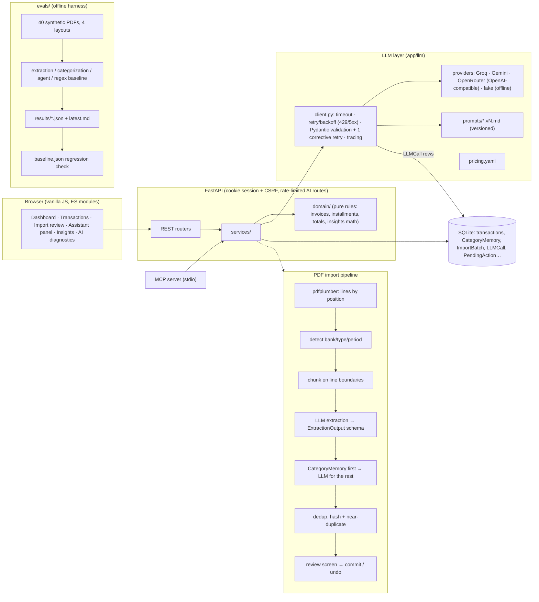

# FinançasIA

Personal-finance app for a family that imports PDF bank statements with an LLM, categorizes spending, and
has an assistant that answers questions and records transactions through function calling. It doubles as an
AI-engineering portfolio: every LLM feature has a versioned prompt, schema-validated output, cost/latency
tracing, and an **eval suite with metrics**.


| Insights | Mobile (dark) |
|---|---|
|  |  |

*UI in Brazilian Portuguese; screenshots use the synthetic demo data from `scripts/seed_demo.py`.*

---

## Architecture



## Evaluation

> **Status:** the eval harness, datasets and CI wiring are done and tested. **The multi-model comparison has
> not been run yet**: this build environment had no provider API keys, and no numbers here were invented. The
> table below is the current `evals/results/latest.md`: the deterministic regex baseline and the offline
> `fake` provider. To fill in the LLM rows, run:
>
> ```bash
> # .env: GROQ_API_KEY=… GEMINI_API_KEY=… OPENROUTER_API_KEY=…
> uv run python -m evals.run --suite all --skip-unavailable --update-baseline
> ```
>
> `latest.md` (comparison table + "which model for which feature" paragraph) is regenerated from the
> measured numbers.

### Current results

| model | extraction F1 | cost / statement | categorization acc. | categ. acc. + memory | agent pass rate |
|---|---|---|---|---|---|
| regex baseline (no LLM) | 0.855 | $0 | — | — | — |
| `fake:fake` (offline stand-in, not an LLM) | 0.855 | $0 | 0.614 | 0.676 | 0.00 |

The regex baseline scores **F1 1.00 on the layout it was written for, F1 1.00 on a second similar layout,
F1 0.00 on the credit-card invoice** (dates like `12 MAR`, no year) and **gets the sign wrong on 81% of
the layout with separate "Entradas/Saídas" columns** (amount accuracy 0.19). It shows why a hand-written
parser per bank doesn't scale, and it sets the bar the LLM has to beat on accuracy *and* justify on cost.

### Methodology

| Suite | Data | Metrics |
|---|---|---|
| **extraction** | 40 synthetic PDFs, 4 invented layouts (checking statements + card invoice), 1,466 transactions with JSON ground truth. Hard cases: descriptions split over two lines, trailing minus (`150,00-`), refunds, installments (`03/10`), PIX with person names, dates without year (incl. year rollover on invoices), headers/footers repeated on every page, daily balance rows mixed with transactions. `evals/private/` (gitignored) takes real statements with hand-made ground truth. | Precision / recall / F1. A predicted transaction matches a gold one on \|amount\| + date ±3 days, so **sign and date errors show up as field accuracy** (date, amount, description similarity ≥ 0.8, type, installment) instead of disappearing as misses. Parse failure rate (chunks that failed schema validation twice), cost per statement, latency p50/p95, F1 per layout. |
| **categorization** | 145 labelled descriptions as statements print them (prefixes, city suffixes, card ids, mixed case) + hand-written hard cases. | Accuracy overall and per category, **with and without `CategoryMemory`**. The memory is seeded with one plain descriptor per merchant (what a single user correction stores), so its gains measure normalization quality, not label leakage. |
| **agent** | 31 cases on a seeded in-memory DB with a fixed "today": writes ("gastei 45 no mercado ontem no Nubank"), questions ("quanto gastei com delivery esse mês?"), installments, transfers, budgets, goals, deletes, and **6 ambiguous cases where the right move is to ask** (missing account, missing amount, "apaga tudo"…). | Right tool, right arguments (resolved to ids), DB state after confirming the proposals, numbers in the answer (expected values are checked against the tools by a unit test), ask-when-ambiguous, **no write before confirmation**, steps, cost, p95. |
| **baseline** | Same 40 PDFs | Regex parser vs. ground truth with the same matcher. |

**Regression.** `evals/baseline.json` holds the headline metrics of the current version. The runner flags
accuracy drops > 3 points and cost/latency increases > 50% (`--fail-on-regression` fails the run).
CI runs the unit tests always, the whole eval harness offline on every push, and a small real-LLM subset
when a `GROQ_API_KEY` secret is configured.

**Prompt versions.** Every `LLMCall` stores its prompt version (`extraction.v1`, `assistant.v1`…). A prompt
change means a new `vN.md` file, `--prompt-version vN` eval runs, and only then a new default. All prompts
are still at **v1**; v1 → v2 comparisons will be recorded here once real-model runs exist.

## Engineering decisions

The full log is in [`docs/decisions.md`](docs/decisions.md). The main ones:

- **Hybrid pipeline: deterministic first, LLM for the rest.** Text extraction, bank/period detection,
  chunking, header/footer stripping, dedup and the `CategoryMemory` lookup are plain Python: free, instant
  and testable. The LLM only does what rules can't do reliably (reading arbitrary layouts, categorizing
  unseen merchants), and memory hits never reach it. User corrections feed the memory, so the LLM bill shrinks
  over time.
- **Validation with one corrective retry.** LLM output is parsed into Pydantic schemas (`ExtractionOutput`,
  `CategorizationOutput`…) with business checks (income can't be negative, installments come in pairs). On
  failure the model gets its own answer plus the validation error **once**; both attempts are traced, so the
  cost of retries shows up in the diagnostics. A chunk that fails twice becomes a visible warning, never
  silently dropped data.
- **On-demand context for the assistant.** Each turn sends only a compact snapshot (today, accounts and
  balances, categories, budgets, goals). Transactions are fetched with `query_transactions`/`get_summary`,
  and the prompt requires every number to come from a tool result. Writes are *proposals*: the model has no
  tool that writes; a human click on the preview executes it after re-validation.
- **Cost × accuracy is a measured trade-off, not a guess.** Provider and model are configurable per
  feature (extraction, categorization, assistant, insights) in `.env` or in the settings screen. Prices live
  in `app/llm/pricing.yaml`, and `LLMCall` stores tokens, cost and latency for every request.
- **Money is integer cents, end to end.** That covers the DB, the API, the LLM schemas and the BRL parser
  (`1.234,56`, `150,00-`, `D/C`). Installment splits put the cent difference in the last installment, so the
  sum is always exact.
- **Insights: Python computes, the LLM writes copy.** Subscriptions, anomalies, budget pace and the
  end-of-month forecast are deterministic. The LLM only rewrites title/body from pre-formatted numbers; any
  mismatch falls back to the default text.

## Features

- Transactions (CRUD, inline edit, filters, global search, month/all-time stats), credit cards with the
  closing-day rule and open invoices, installments (one per invoice, exact sum, delete one or all),
  transfers (excluded from income/expense), idempotent recurring rules, budgets (80%/100% alerts), goals,
  JSON backup/restore and CSV export, light/dark theme, shortcuts (`Ctrl+N`, `Ctrl+I`, `Ctrl+/`),
  responsive layout.
- PDF import with a review screen (duplicates, low confidence and installment badges, editable rows), jump
  to the statement's latest month, batch history with undo.
- Assistant side panel with confirmation cards; AI diagnostics page (cost by feature, calls per day,
  p50/p95, error rate, recent failures).
- Family login (bcrypt, server-side sessions, HTTP-only cookie + CSRF header), rate-limited AI endpoints,
  strict CSP, PDFs processed in memory only, payload logging off by default (`LLM_LOG_PAYLOADS`).
- MCP server: `get_summary`, `query_transactions`, `create_transaction` with confirmation (elicitation or a
  two-step fallback); see [`docs/mcp.md`](docs/mcp.md).

## Running

**Locally** (Python 3.12 + [uv](https://docs.astral.sh/uv/)):

```bash
cp .env.example .env            # add at least one provider key (GROQ_API_KEY / GEMINI_API_KEY / OPENROUTER_API_KEY)
uv sync
uv run uvicorn app.main:app --reload
# http://localhost:8000 → first access creates the admin user
```

Without keys, the app runs fully except AI features, which return a clear error. In development you can
select the offline `fake` provider in *Configurações → IA* to click through import/assistant flows.

Demo data: `DATABASE_URL=sqlite:///data/demo.db uv run python -m scripts.seed_demo` (login `demo` / `demo1234`).

**Docker:**

```bash
cp .env.example .env            # optional, for AI keys
docker compose up --build       # http://localhost:8000, data in the financasia-data volume
```

**Tests, lint, evals:**

```bash
uv run pytest                   # unit + API + MCP stdio tests
uv run ruff check . && uv run ruff format --check .
uv run python -m evals.generators.statements --count 40   # regenerate synthetic PDFs (deterministic seed)
uv run python -m evals.run --suite all --subset ci --models fake:fake   # offline smoke run
uv run python -m evals.run --suite extraction --models groq:openai/gpt-oss-20b,gemini:gemini-3.5-flash-lite
```

## Known limitations and next steps

- **Real-model eval numbers are pending** (see Evaluation). Next: run the 6-model line-up in
  `evals/config.yaml`, pick per-feature defaults from the data, then iterate prompts as `v2` with
  before/after numbers.
- No OCR: scanned PDFs are rejected with a clear message (out of scope).
- The synthetic layouts are clean PDFs; real bank statements are messier. `evals/private/` exists so real
  statements with hand-made ground truth can be scored locally without being committed.
- SQLite + `create_all` (no Alembic migrations yet); fine for one household, but it needs migrations before
  schema changes on real data.
- Rate limiting is in-memory (single process).
- The assistant can't record refunds or edit existing transactions yet (create/delete only).
- No direct bank integration (Open Finance), no native mobile app (out of scope).

Build log: [`PROGRESS.md`](PROGRESS.md).
