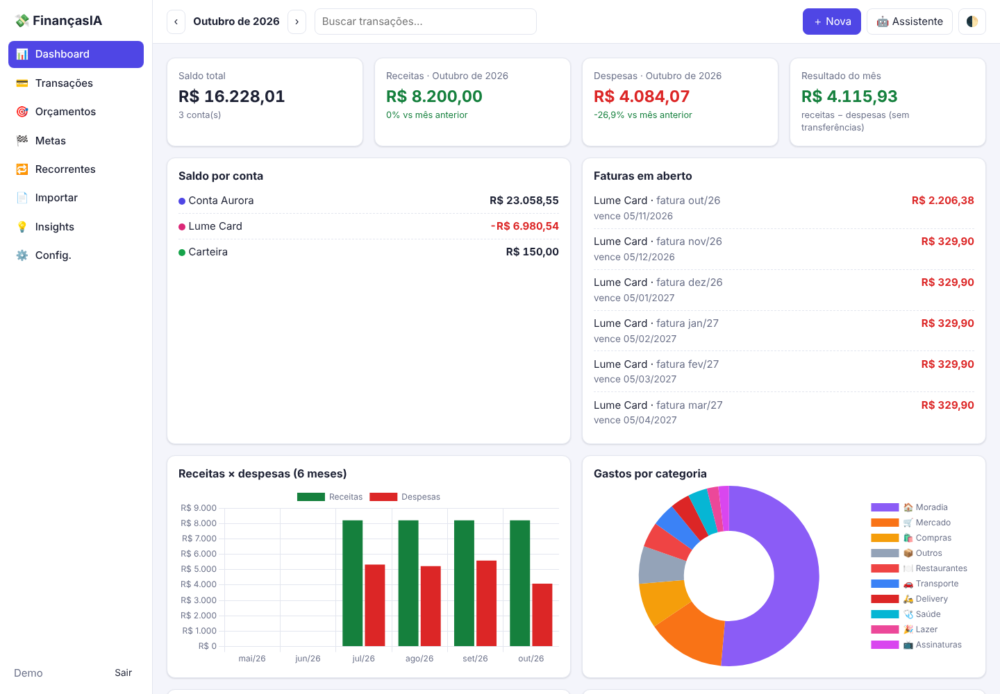
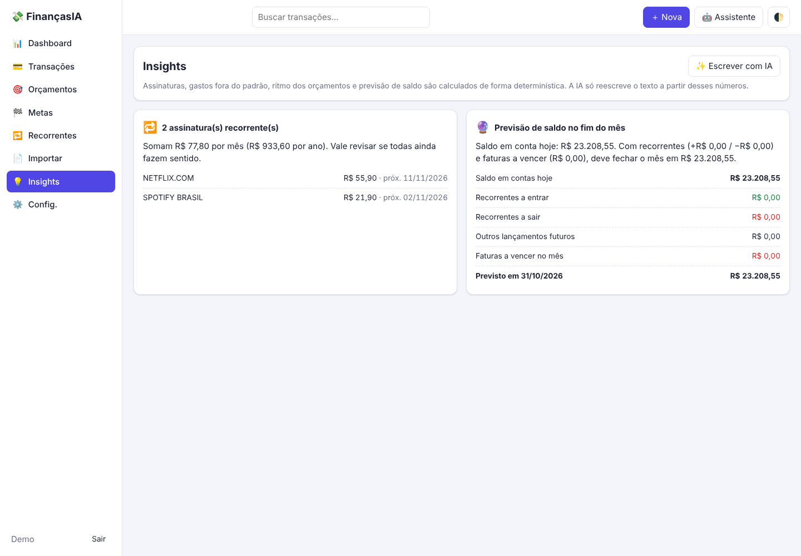
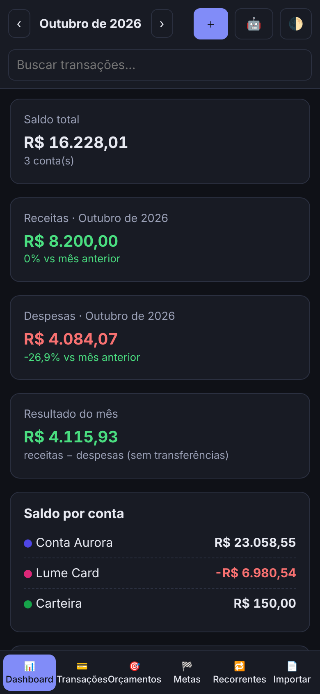
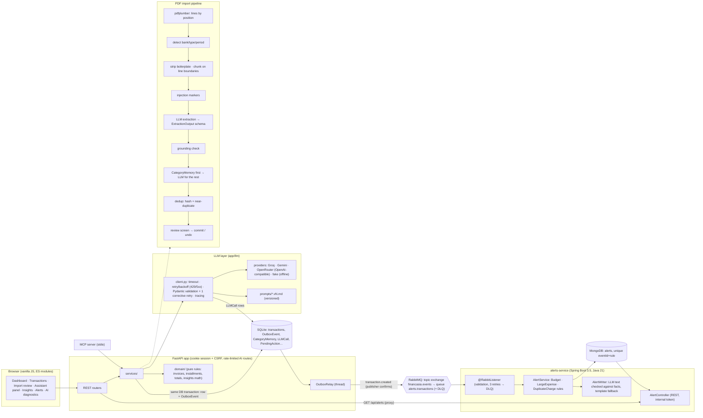
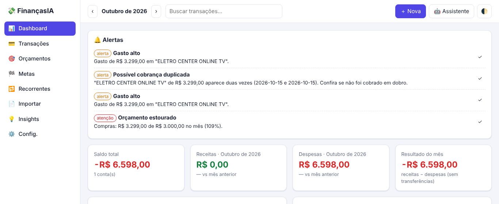

# FinançasIA

[](https://github.com/FelipeYabiko/FinancasAI/actions/workflows/ci.yml)

Personal-finance app for a family that imports PDF bank statements with an LLM, categorizes spending, and
has an assistant that answers questions and records transactions through function calling. It doubles as an
AI-engineering portfolio: every LLM feature has a versioned prompt, schema-validated output, cost/latency
tracing, and an **eval suite with metrics**. A **Java/Spring Boot microservice** consumes the app's events
from RabbitMQ (transactional outbox, idempotent consumer, DLQ) and raises spending alerts.



| Insights | Mobile (dark) |
|---|---|
|  |  |

*UI in Brazilian Portuguese; screenshots use the synthetic demo data from `scripts/seed_demo.py`.*

## Skills map

| Skill | Where to look |
|---|---|
| Java 21 + Spring Boot 3.5, REST | [`alerts-service/`](alerts-service): records, constructor injection, `@ConfigurationProperties`, `ProblemDetail` errors |
| Microservices + messaging (RabbitMQ) | [`app/services/events.py`](app/services/events.py) (transactional outbox, publisher confirms) → [`TransactionEventListener`](alerts-service/src/main/java/io/github/felipeyabiko/financasia/alerts/messaging/TransactionEventListener.java) (retry, DLQ, idempotent by `eventId`) |
| Design patterns | Strategy (`AlertRule`, `AlertWriter` LLM/template), Adapter (`LLMProvider`), Repository, Outbox |
| SQL + NoSQL | SQLModel/SQLite for the ledger; Spring Data MongoDB for alerts (unique compound index) |
| LLMs in production | [`app/llm/`](app/llm): provider layer, versioned prompts, schema validation + corrective retry, retries honoring `retry-after`, per-call cost/latency tracing |
| Function calling / agents | [`app/services/assistant/`](app/services/assistant): read tools run, write tools become `PendingAction`s a human confirms |
| LLM evaluation | [`evals/`](evals): P/R/F1 on 40 synthetic PDFs, agent cases, regex baseline, prompt-version comparison, regression check |
| LLM security | Prompt-injection defenses + adversarial eval suite ([below](#prompt-injection-defenses)) |
| Testing | pytest (100 tests); JUnit 5 + Mockito, `@WebMvcTest`, Testcontainers (RabbitMQ + MongoDB), contract test shared with Python |
| Docker / Kubernetes / CI | Multi-stage Dockerfiles, `docker-compose.yml` (4 services), [`k8s/`](k8s) (Kustomize, probes, StatefulSets), GitHub Actions with kubeconform and environment secrets |

---

## Architecture



## Evaluation

> **Status:** one real model measured so far, `groq:openai/gpt-oss-20b`, on the CI subset (4 statements, one
> per layout, plus 6 agent cases), with two extraction prompt versions compared side by side. The full 40-statement run doesn't fit
> Groq's free-tier daily token quota (a first attempt ran out of quota after ~30 statements), so it and the
> multi-model comparison (Gemini, OpenRouter) are still pending. Every number below comes from
> `evals/results/`; none is hand-written.

### Current results (CI subset)

| model / prompt | eval set | extraction F1 | precision / recall | amount acc. | cost / statement | agent pass rate | cost / agent case |
|---|---|---|---|---|---|---|---|
| `gpt-oss-20b` · `extraction.v2` (**default**) | 4 PDFs | 0.962 | 0.98 / 0.94 | **1.00** | US$ 0.0008 | — | — |
| `gpt-oss-20b` · `extraction.v1` | same 4 PDFs, same run | **0.970** | 1.00 / 0.94 | 0.73 | US$ 0.0007 | — | — |
| `gpt-oss-20b` · `assistant.v1` | 6 cases | — | — | — | — | **6/6** | US$ 0.0003 |
| regex baseline (no LLM) | same 4 PDFs | 0.867 | 1.00 / 0.76 | 0.77 | $0 | — | — |

Per layout (F1 · amount accuracy):

| | aurora (checking, signed column) | ipe (checking, `150,00-`, 2-line descriptions) | lume (card invoice, `12 MAR`, installments) | maré (checking, in/out columns) |
|---|---|---|---|---|
| `extraction.v2` | 1.00 · 1.00 | 0.95 · **1.00** | 0.90 · 1.00 | 1.00 · 1.00 |
| `extraction.v1` | 1.00 · 1.00 | 0.95 · **0.13** | 0.93 · 1.00 | 1.00 · 1.00 |
| regex baseline | 1.00 · 1.00 | 1.00 · 1.00 | 0.00 · — | 1.00 · 0.17 |

What the numbers say:

- **`extraction.v2` fixed the sign errors it was written for.** On the trailing-minus layout (`150,00-`) v1
  got the sign right on 5 of 39 rows; v2 on 39 of 39. F1 can't see this, because transactions are matched on
  |amount|, which is why amount accuracy is reported next to it. F1 is a tie (0.962 vs 0.970: v2 added 2
  false positives on the invoice, one of them already flagged by the grounding check). A wrong sign turns an
  expense into income, so v2 is the default ([D28](docs/decisions.md)).
- **The LLM reads layouts the regex can't:** the card invoice goes from F1 0.00 to 0.90+. On the in/out-column
  layout the regex finds every row but gets the sign wrong on most of them; the LLM gets all of them right.
- **Runs vary a lot on 4 documents:** v1 scored 0.925 and 0.958 in earlier runs, 0.970 in this one (invoice
  recall 0.53 → 0.88). Differences of a few F1 points between single runs aren't signal; the 39/39 vs 5/39
  sign result is.
- **Latency isn't comparable between the two prompts here:** with Groq's free tier (8k tokens/min) and one
  chunk at a time, the second version run mostly waits on `retry-after`.
- **Agent:** right tool, arguments and final state in every write case; it asked "qual conta?" in the
  ambiguous case; nothing was written before confirmation; the spending answer (R$ 123,40) came from
  `get_summary`.
- **Getting there took five fixes**, all found by running evals against the real API and now covered by
  tests: echoing output-only fields (`reasoning`) back to the API, the 8k tokens/min limit (honoring
  `retry-after`), JSON-mode `json_validate_failed` errors, empty answers from the reasoning model
  (`reasoning_effort=low`), and rate-limited chunks being scored as missed transactions (now *skipped*,
  [D27](docs/decisions.md)).

On the full 40-statement set the regex baseline scores F1 0.855 (1.00 / 1.00 / 0.00 / 1.00 by layout).

To reproduce or extend:

```bash
# .env: GROQ_API_KEY=… GEMINI_API_KEY=… OPENROUTER_API_KEY=…
uv run python -m evals.run --suite all --skip-unavailable --update-baseline   # full sets, every configured model
```

### Methodology

| Suite | Data | Metrics |
|---|---|---|
| **extraction** | 40 synthetic PDFs, 4 invented layouts (checking statements + card invoice), 1,466 transactions with JSON ground truth. Hard cases: descriptions split over two lines, trailing minus (`150,00-`), refunds, installments (`03/10`), PIX with person names, dates without year (incl. year rollover on invoices), headers/footers repeated on every page, daily balance rows mixed with transactions. `evals/private/` (gitignored) takes real statements with hand-made ground truth. | Precision / recall / F1. A predicted transaction matches a gold one on \|amount\| + date ±3 days, so **sign and date errors show up as field accuracy** (date, amount, description similarity ≥ 0.8, type, installment) instead of disappearing as misses. Parse failure rate (chunks that failed schema validation twice), cost per statement, latency p50/p95, F1 per layout. |
| **categorization** | 145 labelled descriptions as statements print them (prefixes, city suffixes, card ids, mixed case) + hand-written hard cases. | Accuracy overall and per category, **with and without `CategoryMemory`**. The memory is seeded with one plain descriptor per merchant (what a single user correction stores), so its gains measure normalization quality, not label leakage. |
| **agent** | 33 cases on a seeded in-memory DB with a fixed "today": writes ("gastei 45 no mercado ontem no Nubank"), questions ("quanto gastei com delivery esse mês?"), installments, transfers, budgets, goals, deletes, **6 ambiguous cases where the right move is to ask** (missing account, missing amount, "apaga tudo"…) and 2 prompt-injection cases (a stored description that tells the assistant to delete everything). | Right tool, right arguments (resolved to ids), DB state after confirming the proposals, numbers in the answer (expected values are checked against the tools by a unit test), ask-when-ambiguous, **no write before confirmation**, steps, cost, p95. |
| **baseline** | Same 40 PDFs | Regex parser vs. ground truth with the same matcher. |

**Regression.** `evals/baseline.json` holds the headline metrics of the current version. The runner flags
accuracy drops > 3 points and cost/latency increases > 50% (`--fail-on-regression` fails the run).
CI runs the unit tests and the whole eval harness offline on every push, and a small real-LLM subset on
`main` when a `GROQ_API_KEY` secret is configured. Documents that hit provider errors (rate limit, exhausted
quota) are reported as *skipped*, never scored as misses, and an incomplete run can't update the baseline.

**Prompt versions.** Every `LLMCall` stores its prompt version (`extraction.v1`, `assistant.v1`…). A prompt
change means a new `vN.md` file, `--prompt-version v1,v2` eval runs, and only then a new default. Extraction
is on **v2** (results above); the other prompts are on v1, and `assistant.v2` (an injection rule) is written
but not yet measured.

## Event-driven alerts service (Java)



`alerts-service/` is a separate Spring Boot service with its own database. The Python app never calls it to
*write*; it announces facts and the service reacts:

1. **Transactional outbox.** A SQLAlchemy session hook adds an `OutboxEvent` row in the same DB transaction
   that creates an income/expense, so a transaction can't be saved without its event (no dual write).
2. **Relay.** A background thread publishes pending rows to the `financasia.events` topic exchange with
   publisher confirms, and only then marks them published. Delivery is **at-least-once**, in order.
3. **Event-carried state.** The `transaction.created` message carries the facts the rules need (category
   spend this month *as of that transaction*, budget, 3-month average), so the consumer never reads the
   app's database. The schema is pinned by [`contracts/transaction-created.example.json`](contracts), tested
   on both sides.
4. **Idempotent consumer.** Alerts have a unique `(eventId, rule)` index and the service skips rules already
   applied to an event, so redeliveries create nothing. Transient failures retry 3× with backoff; malformed or
   still-failing messages go to `alerts.transactions.dlq`.
5. **Rules as strategies.** `BudgetRule` (crossing 80% / 100%), `LargeExpenseRule`, `DuplicateChargeRule`;
   adding a rule is adding a bean. Alert text can be written by an LLM, but any `R$` value it cites must be in
   the facts, otherwise the deterministic template is used.
6. **Read path.** The app proxies `GET /api/alerts` to the service with an internal token and degrades to "no
   alerts" when it isn't configured.

Tests: rule unit tests, `AlertService` with Mockito, `@WebMvcTest` for the API, a contract test, and an
integration test with **Testcontainers** (real RabbitMQ + MongoDB) covering redelivery and the DLQ.

## Prompt-injection defenses

Statement lines and stored descriptions are untrusted text that reaches the model. Defense in layers:

| Layer | Where |
|---|---|
| Data is delimited and the prompt says it is data, not instructions | `extraction.v2.md`, `extraction.py` |
| Instruction-like lines are flagged to the user in the import review | `app/services/importer/guards.py` |
| Grounding: an extracted amount that doesn't appear in its chunk gets confidence ≤ 0.3 | `guards.py`, `extraction.py` |
| Only the user's messages can request actions; tool output is data | `assistant.v2.md` |
| The model can only *propose* writes; a human confirms | `PendingAction` |
| Measured: adversarial PDFs (attack success / detection rate) and agent injection cases | `evals/suites/injection.py`, `agent_cases.yaml` |

## Engineering decisions

The full log is in [`docs/decisions.md`](docs/decisions.md). The main ones:

- **Hybrid pipeline: deterministic first, LLM for the rest.** Text extraction, bank/period detection,
  chunking, header/footer stripping, dedup and the `CategoryMemory` lookup are plain Python: free, instant
  and testable. The LLM only does what rules can't do reliably (reading arbitrary layouts, categorizing
  unseen merchants), and memory hits never reach it. User corrections feed the memory, so the LLM bill shrinks
  over time.
- **Validation with one corrective retry.** LLM output is parsed into Pydantic schemas (`ExtractionOutput`,
  `CategorizationOutput`…) with business checks (income can't be negative, installments come in pairs). On
  failure the model gets its own answer plus the validation error **once**; both attempts are traced, so the
  cost of retries shows up in the diagnostics. A chunk that fails twice becomes a visible warning, never
  silently dropped data.
- **On-demand context for the assistant.** Each turn sends only a compact snapshot (today, accounts and
  balances, categories, budgets, goals). Transactions are fetched with `query_transactions`/`get_summary`,
  and the prompt requires every number to come from a tool result. Writes are *proposals*: the model has no
  tool that writes; a human click on the preview executes it after re-validation.
- **Cost × accuracy is a measured trade-off, not a guess.** Provider and model are configurable per
  feature (extraction, categorization, assistant, insights) in `.env` or in the settings screen. Prices live
  in `app/llm/pricing.yaml`, and `LLMCall` stores tokens, cost and latency for every request.
- **Money is integer cents, end to end.** That covers the DB, the API, the LLM schemas and the BRL parser
  (`1.234,56`, `150,00-`, `D/C`). Installment splits put the cent difference in the last installment, so the
  sum is always exact.
- **Insights: Python computes, the LLM writes copy.** Subscriptions, anomalies, budget pace and the
  end-of-month forecast are deterministic. The LLM only rewrites title/body from pre-formatted numbers; any
  mismatch falls back to the default text.

## Features

- Transactions (CRUD, inline edit, filters, global search, month/all-time stats), credit cards with the
  closing-day rule and open invoices, installments (one per invoice, exact sum, delete one or all),
  transfers (excluded from income/expense), idempotent recurring rules, budgets (80%/100% alerts), goals,
  JSON backup/restore and CSV export, light/dark theme, shortcuts (`Ctrl+N`, `Ctrl+I`, `Ctrl+/`),
  responsive layout.
- PDF import with a review screen (duplicates, low confidence and installment badges, editable rows), jump
  to the statement's latest month, batch history with undo.
- Assistant side panel with confirmation cards; AI diagnostics page (cost by feature, calls per day,
  p50/p95, error rate, recent failures).
- Family login (bcrypt, server-side sessions, HTTP-only cookie + CSRF header), rate-limited AI endpoints,
  strict CSP, PDFs processed in memory only, payload logging off by default (`LLM_LOG_PAYLOADS`).
- MCP server: `get_summary`, `query_transactions`, `create_transaction` with confirmation (elicitation or a
  two-step fallback); see [`docs/mcp.md`](docs/mcp.md).

## Running

**Locally** (Python 3.12 + [uv](https://docs.astral.sh/uv/)):

```bash
cp .env.example .env            # add at least one provider key (GROQ_API_KEY / GEMINI_API_KEY / OPENROUTER_API_KEY)
uv sync
uv run uvicorn app.main:app --reload
# http://localhost:8000 → first access creates the admin user
```

Without keys, the app runs fully except AI features, which return a clear error. In development you can
select the offline `fake` provider in *Configurações → IA* to click through import/assistant flows.

Demo data: `DATABASE_URL=sqlite:///data/demo.db uv run python -m scripts.seed_demo` (login `demo` / `demo1234`).

**Docker** (app + alerts-service + RabbitMQ + MongoDB):

```bash
cp .env.example .env            # optional, for AI keys
docker compose up --build       # http://localhost:8000 · RabbitMQ UI http://localhost:15672
```

**Kubernetes:** see [`k8s/README.md`](k8s/README.md) (`kubectl apply -k k8s`).

**Tests, lint, evals:**

```bash
uv run pytest                   # unit + API + MCP stdio tests
(cd alerts-service && ./mvnw verify)   # Java unit + Testcontainers integration tests (needs Docker)
uv run ruff check . && uv run ruff format --check .
uv run python -m evals.generators.statements --count 40   # regenerate synthetic PDFs (deterministic seed)
uv run python -m evals.run --suite all --subset ci --models fake:fake   # offline smoke run
uv run python -m evals.run --suite extraction --models groq:openai/gpt-oss-20b,gemini:gemini-3.5-flash-lite
```

## Known limitations and next steps

- **Only one model measured, on a 4-statement subset** (see Evaluation). The full 40-statement set needs more
  than Groq's free daily quota. Next: run it (paid tier or spread over days) plus the multi-model line-up in
  `evals/config.yaml`, pick per-feature defaults from the data, and measure `assistant.v2` and the injection
  suite on a real model.
- No OCR: scanned PDFs are rejected with a clear message (out of scope).
- The synthetic layouts are clean PDFs; real bank statements are messier. `evals/private/` exists so real
  statements with hand-made ground truth can be scored locally without being committed.
- SQLite + `create_all` (no Alembic migrations yet); fine for one household, but it needs migrations before
  schema changes on real data.
- Rate limiting is in-memory (single process).
- The assistant can't record refunds or edit existing transactions yet (create/delete only).
- No direct bank integration (Open Finance), no native mobile app (out of scope).

Build log: [`PROGRESS.md`](PROGRESS.md).
